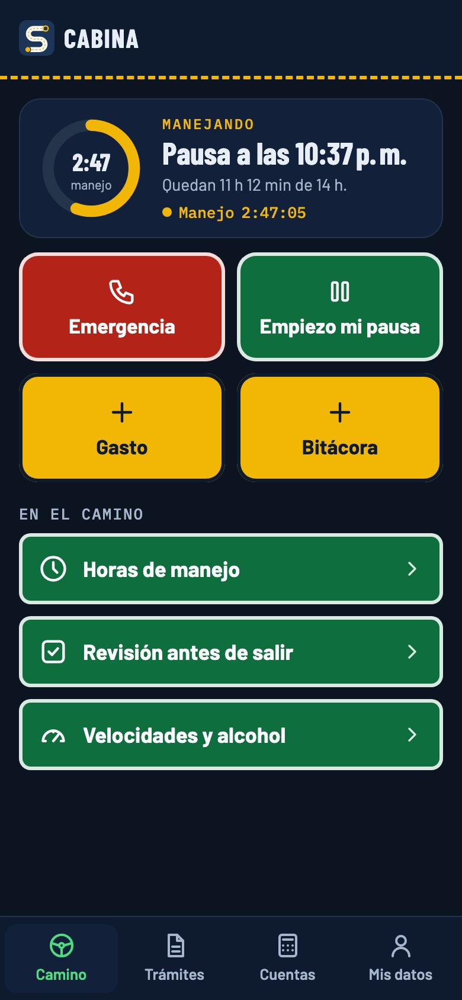
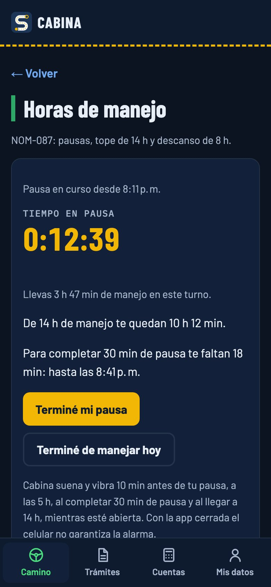
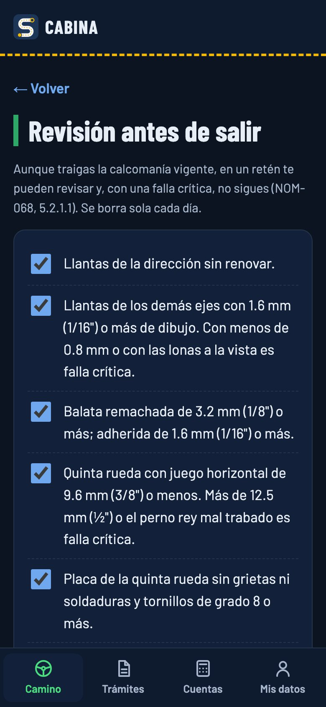
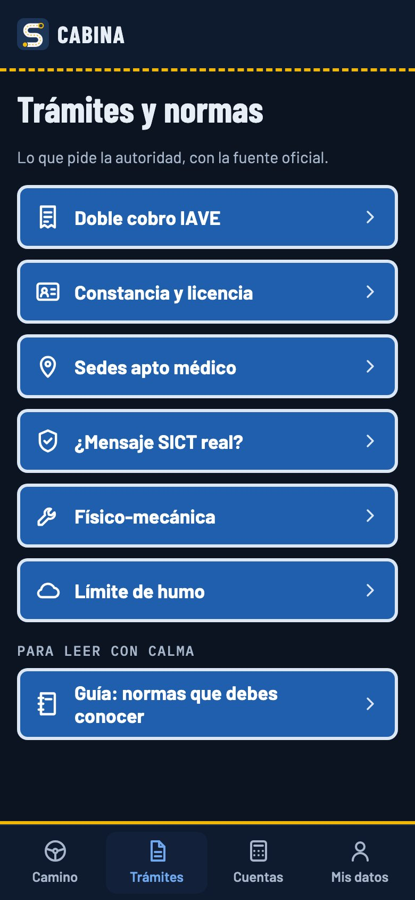
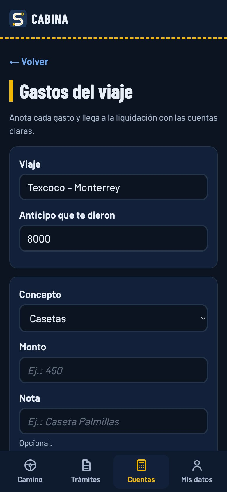
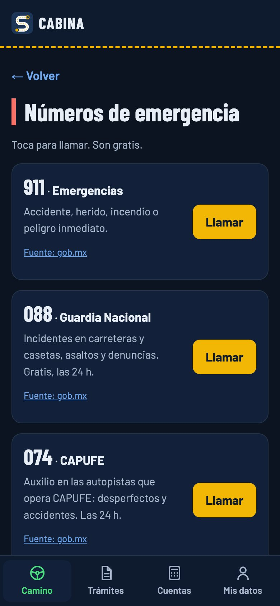
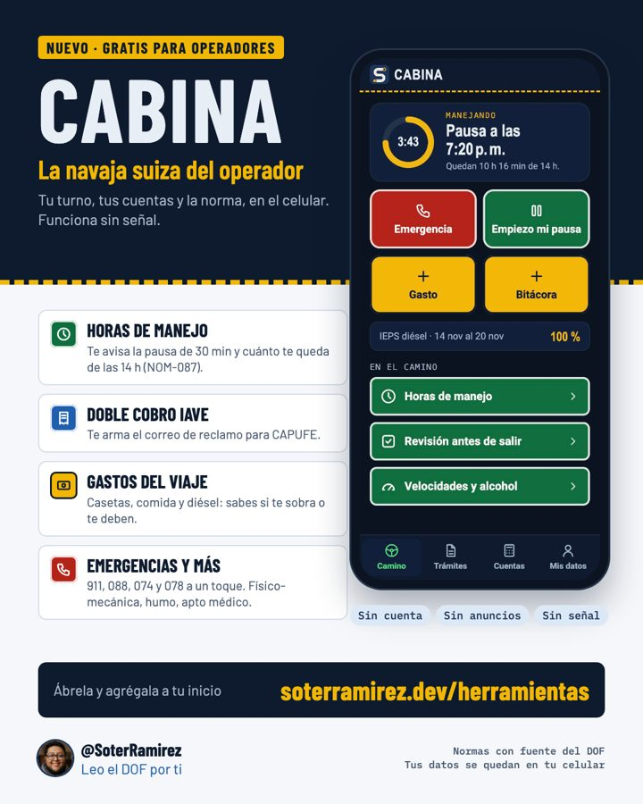
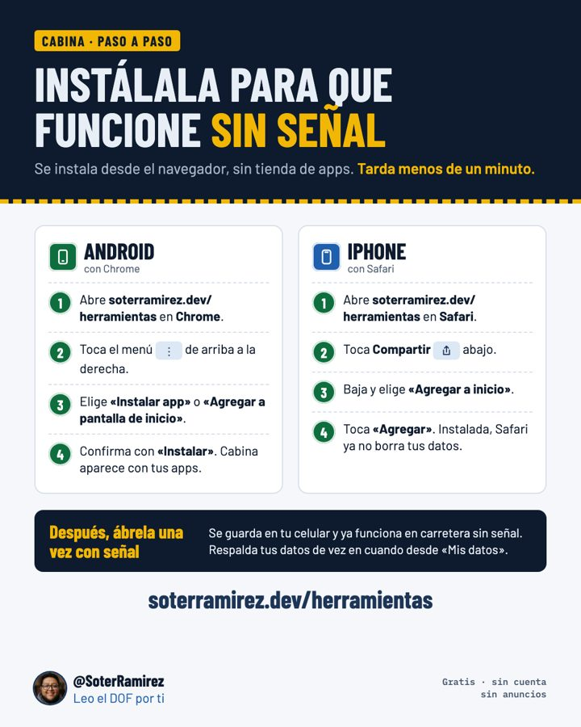

<p align="center">
  
</p>

<h1 align="center">Cabina</h1>

<p align="center">
  <strong>La navaja suiza del operador de camiones.</strong><br>
  Herramientas gratis para el autotransporte en México: normas, trámites, cuentas del viaje y bitácora.<br>
  Sin cuentas, sin anuncios y funciona sin señal.
</p>

<p align="center">
  <a href="https://soterramirez.dev/herramientas/"><strong>👉 Úsala en soterramirez.dev/herramientas</strong></a>
  &nbsp;·&nbsp;
  <a href="https://www.facebook.com/groups/bolsadetrabajoparaoperadores">Grupo de operadores de la 57</a>
  &nbsp;·&nbsp;
  <a href="https://github.com/SoterRamirez/cabina/actions/workflows/pruebas.yml"></a>
</p>

<p align="center">
  
  &nbsp;
  
  &nbsp;
  
</p>

## Qué trae

| En el camino | Normas y trámites | Cuentas y bitácora |
|---|---|---|
| **Horas de manejo** (NOM-087): reloj en vivo, aviso de la pausa de 30 min, tope de 14 h y descanso de 8 h | **Doble cobro IAVE**: te arma el correo de aclaración para CAPUFE | **Gastos del viaje** y liquidación contra el anticipo |
| **Revisión antes de salir** (NOM-068): se borra sola cada día | **Constancia y licencia**: cuánto te queda y aviso 30 días antes | **Bitácora personal** exportable |
| **Velocidades y alcohol** (Reglamento de Tránsito) | **Sedes del Mes del Apto Médico 2026** con buscador y mapa | **Diésel**: rendimiento y costo del viaje |
| **Números de emergencia** (911, 088, 074, 078, 089) a un toque | **¿Es real el mensaje de la SICT?**: detecta enlaces falsos y letras disfrazadas | **Ganancia por km** y por hora |
| | **Físico-mecánica** según tu placa (NOM-068) y **límite de humo** por año-modelo (NOM-045) | **Convertidor** (mm↔pulg, kg↔lb, psi↔bar…) |

<p align="center">
  
  &nbsp;
  
  &nbsp;
  
</p>

## Instálala en tu celular

Se instala desde el navegador, sin tienda de apps, y tarda menos de un minuto. Después de abrirla una vez con señal, funciona en carretera sin internet.

| Android (Chrome) | iPhone (Safari) |
|---|---|
| 1. Abre **soterramirez.dev/herramientas** en Chrome.<br>2. Toca el menú **⋮** de arriba a la derecha.<br>3. Elige **Instalar app** o **Agregar a pantalla de inicio**.<br>4. Confirma con **Instalar**. | 1. Abre **soterramirez.dev/herramientas** en Safari.<br>2. Toca **Compartir** abajo.<br>3. Baja y elige **Agregar a inicio**.<br>4. Toca **Agregar**. Instalada, Safari ya no borra tus datos. |

<p align="center">
  
  &nbsp;
  
</p>

<p align="center"><em>Las imágenes con las que presentamos Cabina en el grupo de operadores.</em></p>

## Comunidad

Cabina nació para el grupo **[Bolsa de trabajo para operadores apasionados por la 57](https://www.facebook.com/groups/bolsadetrabajoparaoperadores)** en Facebook. Ahí se anuncian las versiones nuevas y se juntan las ideas.

- **¿Te falta una herramienta o algo no funciona?** Déjalo en los [comentarios de la publicación de sugerencias](https://www.facebook.com/groups/bolsadetrabajoparaoperadores/permalink/2604417443361014/) o abre un *issue* aquí.
- **¿Encontraste un dato que cambió?** Mándalo con el enlace al DOF o a gob.mx. Sin fuente no se publica.

## Reglas de la casa

- **Solo fuentes oficiales.** Todo dato de normas sale del DOF o de sitios gob.mx, con la cita en la misma pantalla («Qué dice la fuente oficial»). Si un dato no está verificado, no entra.
- **Tus datos son tuyos.** Todo se guarda en el celular (`localStorage`); nada se manda a un servidor. Hay respaldo y restauración en un archivo desde «Mis datos».
- **Funciona sin señal.** Un service worker guarda la app la primera vez que se abre y busca versión nueva al volver a ella.
- **Hecha para la cabina.** Botones de 44 px o más, letras grandes, colores de señalamiento y nada que se seleccione por error con el dedo.

## Cómo está hecha

HTML, CSS y JavaScript sin dependencias ni paso de construcción.

```
index.html            app y rutas (#/horas, #/gastos…)
js/app.js             inicio, rutas, respaldo e instalación
js/normas.js          NOM-087, NOM-068, NOM-045 y Reglamento
js/tramites.js        emergencias, IAVE, constancia, sedes, mensajes SICT
js/cuentas.js         diésel, convertidor, gastos, ganancia y bitácora
js/ui.js              ayudantes compartidos
datos/                sedes del Mes del Apto Médico (DOF 13/11/2026)
tests/                pruebas automáticas (node --test)
fuentes/              Barlow, Barlow Condensed e IBM Plex Mono (SIL OFL 1.1)
docs/img/             capturas e imágenes de este README
sw.js                 modo sin señal
```

### Pruebas

Node 20 o más nuevo, sin instalar nada:

```bash
npm test
```

Cubren lo que no puede fallar en carretera:

- **Horas de manejo (NOM-087):** pausas de 30 min que se pueden repartir, tope de 14 h, descanso de 8 h antes de otro turno, avisos, reloj en vivo y borrar un turno de prueba.
- **Vencimientos:** cuántos días le quedan a tu constancia y a tu licencia, y el periodo del Mes del Apto Médico.
- **Revisión antes de salir:** que lo palomeado ayer no cuente hoy.

GitHub las corre solas en cada cambio (pestaña *Actions*). Si cambias `js/normas.js`, corre las pruebas antes de publicar.

### Probarla en tu compu

```bash
python3 -m http.server 8000
```

y abre `http://localhost:8000`. Al cambiar cualquier archivo, sube `VERSION` en `sw.js` para que los celulares descarguen la versión nueva.

## Aviso

Cabina es orientativa y resume la norma vigente a la fecha indicada en cada herramienta. Ante cualquier duda, manda el texto oficial. El aviso completo está en la app, en «Mis datos → Aviso de responsabilidad».

---

<p align="center">
  Hecha por <strong>Soter Ramírez</strong> · <a href="https://soterramirez.dev">soterramirez.dev</a> · <em>Leo el DOF por ti</em><br>
  Licencia MIT
</p>
